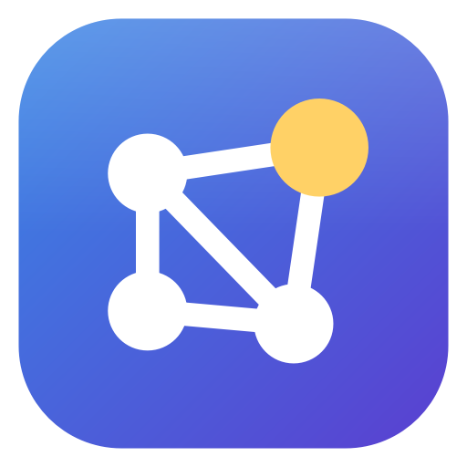

<p align="center">
  
</p>

<h1 align="center">ZettelApp</h1>

<p align="center"><b>A Zettelkasten for Windows that helps you connect ideas.</b><br>
Atomic notes, typed links, mind maps, flashcards, a 2D/3D knowledge graph, and link suggestions that learn from you.</p>

<p align="center">
  <a href="https://github.com/DutraIRS/ZettelApp/releases/latest/download/ZettelApp-Setup.exe"><b>Download for Windows</b></a> ·
  <a href="https://github.com/DutraIRS/ZettelApp/releases/latest/download/ZettelApp-Portable.zip">Portable .zip</a> ·
  <a href="https://dutrairs.github.io/ZettelApp/">Website</a> ·
  <a href="https://dutrairs.github.io/ZettelApp/docs/">Documentation</a>
</p>


## Features

- **Atomic notes in Markdown**, saved automatically. Each note has a timestamp ID, and can have tags
  (also written as `#tags` in the text), a source link, images (paste or drop), links to local files and a
  picture. Ctrl+click follows links and tags in the editor.
- **Typed, optionally directed links**: `supports:: [[Claim]]`, *contradicts*, *extends*, *example of*,
  *part of*, *cites*, or your own types. Backlinks read naturally (*Supported by*), and every type can
  have its own line style and arrow tip.
- **Link suggestions that learn**: a Naive Bayes classifier combines semantic (LSA), keyword (TF-IDF),
  Levenshtein and Jaro-Winkler string similarity, shared tags and shared links. Accept or dismiss a
  suggestion and the model learns; hover to see *why* it was suggested.
- **Knowledge graph in 2D and 3D**, coloured by tag or by **k-means / hierarchical clusters** of meaning,
  with groups pulled together on shaded backgrounds, and local graphs around any note.
- **Mind maps** inside notes, with links to notes and PNG/SVG/FreeMind export.
- **Flashcards and quizzes**: `Q:`/`A:` and `{{c1::cloze}}` cards from your text, SM-2 spaced repetition,
  multiple choice, typed answers and *Name that note*.
- **Anki**: sync through AnkiConnect or export `.apkg` decks; links on cards open the note.
- **Zotero**: cite references and create literature notes linked to the item and its PDF.
- **Ask your notes**: answers with citations from Anthropic Claude, OpenAI or Z.ai, using your own key,
  stored in Windows Credential Manager.
- **MCP server**: let Claude Desktop, Claude Code and other MCP clients search and read your vault, only
  while ZettelApp is open with its status-bar MCP switch on (read-only by default).
- **Learn by doing** with *The Lost Prince of the Archive*, an optional first-run adventure that guides
  you through ZettelApp's main features.
- **Export the whole collection or any subgraph**: ZettelApp archive, Markdown (Obsidian), static website,
  JSON, GraphML, Graphviz and Anki. Imports Markdown folders and Obsidian vaults.
- **At home on Windows**: follows your light/dark theme and accent colour, with standard menus and
  shortcuts, a per-user installer and daily backups.
- **Private and safe by design**: works offline; nothing leaves your computer unless you ask for it, apart
  from one small, optional update check at start-up. Notes can't run scripts, imports are sandboxed, and
  API keys never touch disk in plain text.

## Install

Download **[ZettelApp-Setup.exe](https://github.com/DutraIRS/ZettelApp/releases/latest/download/ZettelApp-Setup.exe)**
(per-user, no admin rights needed) or the
**[portable zip](https://github.com/DutraIRS/ZettelApp/releases/latest/download/ZettelApp-Portable.zip)**.
Requires Windows 10 (21H2+) or 11, 64-bit. Checksums are listed on the
[release page](https://github.com/DutraIRS/ZettelApp/releases/latest). See
[Getting started](docs/getting-started.md).

## Build from source

```powershell
git clone https://github.com/DutraIRS/ZettelApp.git
cd ZettelApp
py -m venv .venv
.venv\Scripts\Activate.ps1
pip install -r requirements-dev.txt
python -m zettelapp          # run
pytest                       # test
pwsh packaging/build.ps1     # build dist/ (app folder, portable zip, installer)
```

More in [docs/development.md](docs/development.md).

## Documentation

Read it on the [website](https://dutrairs.github.io/ZettelApp/docs/) or in [`docs/`](docs/index.md).
New to the method? Start with **[What is a Zettelkasten?](docs/what-is-zettelkasten.md)** and the
**[tutorial: your first 30 minutes](docs/tutorial.md)**.

- [Getting started](docs/getting-started.md)
- [Notes and links](docs/notes-and-links.md)
- [Link suggestions](docs/link-suggestions.md)
- [Graph and Insights](docs/graph-and-insights.md)
- [Review, quizzes and Anki](docs/review-and-anki.md)
- [Zotero](docs/zotero.md)
- [Ask your notes (AI)](docs/ai-assistant.md)
- [MCP server](docs/mcp-server.md)
- [MCP API reference](docs/mcp-reference.md)
- [Export and import](docs/export-import.md)
- [Keyboard shortcuts](docs/keyboard-shortcuts.md)
- [Privacy and security](docs/privacy-and-security.md)
- [FAQ](docs/faq.md)

What's next: see the [roadmap](ROADMAP.md), including app translations and Linux packages.

## Sponsor

ZettelApp is free, public-domain software built in the open. If it saves you time, or you want to see the
roadmap happen sooner, please consider sponsoring:

- **Ko-fi:** https://ko-fi.com/dutrairs
- **Companies:** sponsorship can fund a specific roadmap item. Get in touch through GitHub.

Sponsors are thanked in the release notes. Thank you! ❤️

## Licence

ZettelApp is free and unencumbered software released into the public domain. See [LICENSE](LICENSE)
(The Unlicense). It builds on open-source components listed in
[THIRD_PARTY_NOTICES.md](THIRD_PARTY_NOTICES.md). Security reports: [SECURITY.md](SECURITY.md).
Contributions: [CONTRIBUTING.md](CONTRIBUTING.md).
