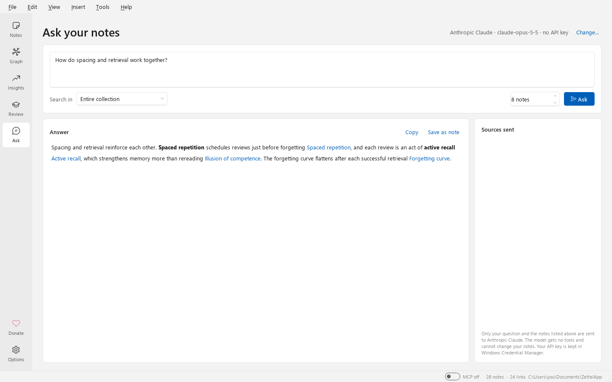

# Ask your notes (AI)

The **Ask** page (Ctrl+5) answers questions **from your notes**, with citations you can click. It uses an
AI provider of your choice with your own API key. It is entirely optional: nothing is sent anywhere until
you ask a question.

## Set up

1. Get an API key from one of the supported providers.
2. Open *Tools ▸ Options ▸ AI assistant*. Choose the **provider**, paste the **API key**, and choose a
   **model** (*Refresh list* asks the provider which models your key can use).

   You can save several keys per provider (for example personal and work). Use *Add key…*, *Rename* and
   *Delete* next to the key list; the selected key is the one used by Ask.
3. Press **Test connection**, then **OK**.

| Provider | Default model | Other suggested models | Endpoint |
|---|---|---|---|
| **Anthropic Claude** (default) | `claude-opus-5-5` | `claude-sonnet-5-5`, `claude-haiku-5-5` | `https://api.anthropic.com` |
| **OpenAI** | `gpt-6.1-sol` | `gpt-6-astra`, `gpt-6-luna` | `https://api.openai.com/v1` |
| **Z.ai (GLM)** | `glm-5.3` | `glm-5.3-flash`, `glm-4.7-flash` | `https://api.z.ai/api/paas/v4` |

You can type any model ID your key has access to. **Endpoint (optional)** overrides the address, for
example to use a Z.ai coding-plan endpoint, an OpenAI-compatible proxy, or a model running on your own
computer (`http://localhost:…`). Addresses must use `https://`; plain `http://` is accepted only for
`localhost`.

With Claude you can also set the **effort** (low to max): higher effort thinks more before answering, and
costs more. The default is *medium*.

## Bring your own LLM

Ask uses **your own account** with the provider you pick, so any usage is billed by that provider to you.
ZettelApp has no AI service of its own. Your API key is saved in **Windows Credential Manager**, never in
settings files.

- **Providers**: Anthropic Claude, OpenAI and Z.ai (GLM), in *Tools ▸ Options ▸ AI assistant ▸ Provider*.
  Pick a **Model** from the list (*Refresh list* asks the provider which models your key can use) or type
  any model ID your key has access to.
- **Your own server**: any service that offers an **OpenAI-style chat completions** API works. Choose
  **OpenAI** and set **Endpoint (optional)** to its base address, for example
  `https://my-proxy.example.com/v1`, `http://localhost:11434/v1` (Ollama) or `http://localhost:1234/v1`
  (LM Studio). Plain `http://` is accepted only for `localhost`, `127.0.0.1` and `::1`; everything else
  must use `https://`. For those local addresses the **API key** may stay empty.
- **Check it**: press **Test connection**. For a local model, your question and notes never leave your
  computer.
- **What is sent**: only your question and the most relevant notes, found on your computer. The number of
  notes is the **how many notes** box on the Ask page (8 by default), and the *Sources sent* list shows
  exactly which ones went.

## Ask a question

Type a question and press **Ask** (Ctrl+Enter). Choose where to look with **Search in**: the entire
collection, the open note and its linked notes, or the notes with a tag. Choose **how many notes** to send.

What happens:

1. ZettelApp finds the most relevant notes **on your computer**, using the same TF-IDF and LSA
   similarity as the [link suggester](link-suggestions.md). With *Current note and linked notes*, the open
   note always comes first.
2. Your question and those notes are sent to the provider, at most 120,000 characters of notes. A note
   cut to fit ends with a visible "[note truncated]" marker. The **Sources sent** list shows exactly which
   notes were sent.
3. The answer streams in as it is written. Citations like `[[20261027153012]]` appear as links to the
   notes. **Stop** cancels it.

The model is told to answer only from your notes and to say when they don't contain the answer. **Copy**
copies the answer as Markdown. **Save as note** keeps it as a new note tagged `ai-answer`, with `cites::`
links to its sources.

## Privacy and safety

- **Only what you ask is sent**: your question and the notes listed under *Sources sent*. A notice
  reminds you of this before you ask (tick *Don't show this again* to skip it).
- **Your API key** is stored in **Windows Credential Manager** (as `ZettelApp/llm/<provider>`, or `ZettelApp/llm/<provider>/<key id>` for further keys), never in
  settings files or logs, and it is removed from any error message shown to you. *Delete* removes it from this computer.
- **The model has no tools.** It can't search the web, run code or change your notes, so instructions
  hidden in a note (or an imported file) can't make it do anything. The answer is shown through the same
  safe renderer as notes, with no HTML or scripts.
- With Claude, ZettelApp uses Anthropic's official SDK and opts into **server-side refusal fallback**: if
  a request is declined by a safety classifier, Anthropic retries it on its recommended fallback model.
  This applies to Claude Opus 5.5, Opus 5, Sonnet 5.5 and Fable 5.1.
- Each provider's own terms and data policies apply to what you send.

## Adding another provider

Providers live in a small registry (`PROVIDERS` in `zettelapp/core/llm.py`). A service that speaks an
existing protocol (Anthropic's Messages API, or OpenAI-style chat completions, which many providers
offer) is **one entry**: its name, endpoint, default model and the page where users get a key. A new
protocol needs a small adapter class. See [Development](development.md).
