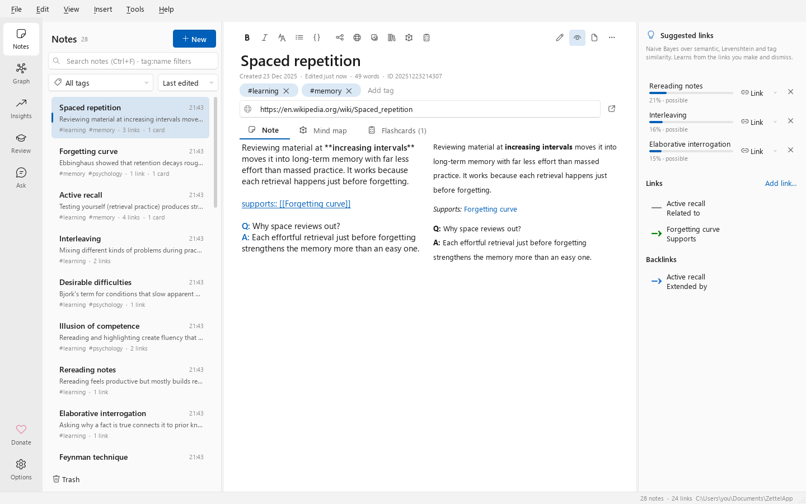
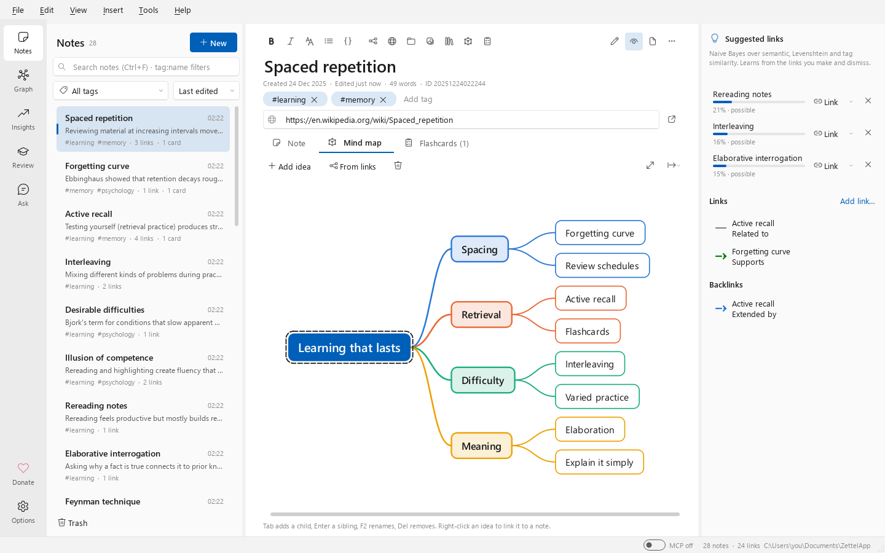
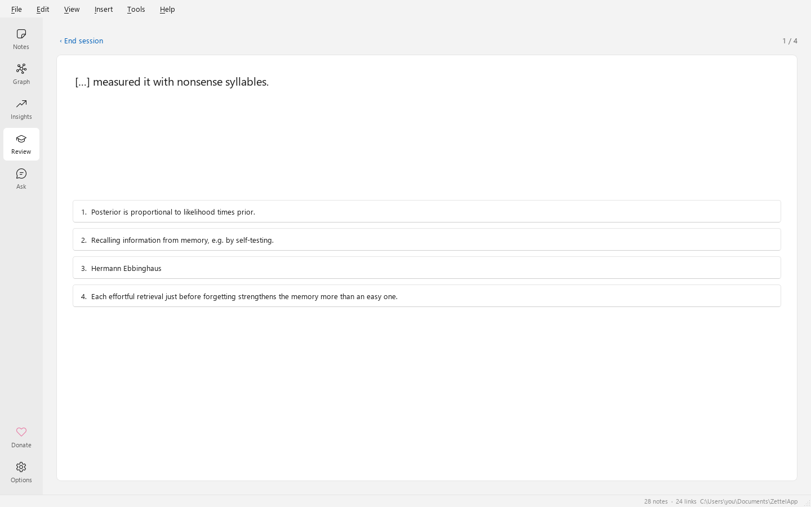
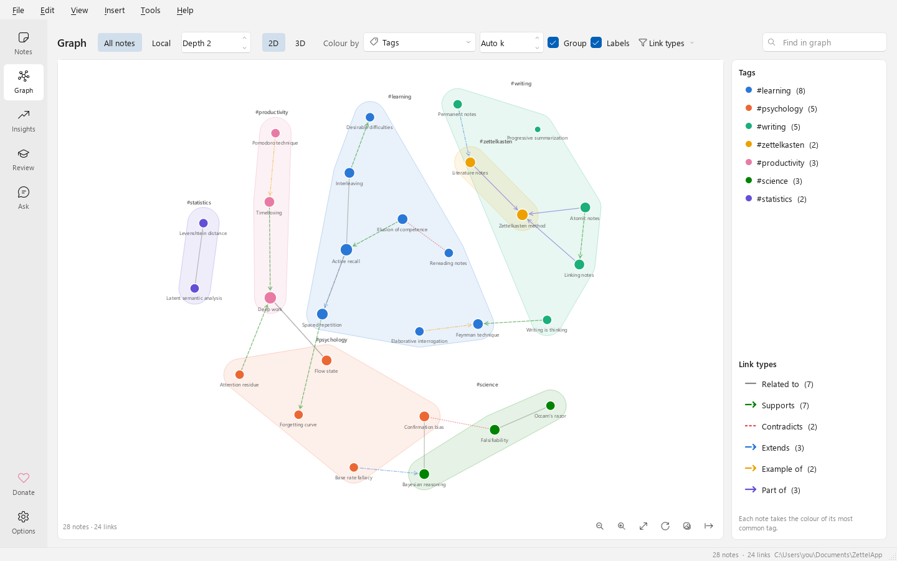

# Tutorial: your first 30 minutes

A hands-on tour. Each step says what to do and what you should see. Steps marked *optional* need Zotero,
an AI key or Anki; skip them if you don't use those.

New to the method itself? Read [What is a Zettelkasten?](what-is-zettelkasten.md) first. It takes five
minutes.

## 1. Install and open the welcome vault

1. Download **ZettelApp-Setup.exe** from the [latest release](https://github.com/DutraIRS/ZettelApp/releases/latest)
   and run it, or unzip **ZettelApp-Portable.zip** and run `ZettelApp.exe`.
2. Start ZettelApp.

**You should see** the Notes page with eleven linked starter notes in a new vault in
*Documents\ZettelApp*. *Start here* is open in the editor. After a moment, ZettelApp also offers the
optional *Lost Princess of the Archive* adventure; choose **Not now** if you prefer this written tour.

## 2. Create a note

1. Press **Ctrl+N**.
2. Type a title, for example *Spaced repetition*, and press **Enter** to move to the text.
3. Write one idea in your own words, in two or three sentences:
   *Reviewing material at increasing intervals helps long-term memory, because each review happens just
   before forgetting.*

**You should see** the note appear at the top of the list. There is no Save button: notes save as you
type. The ID under the title (for example `20261027153012`) is the note's permanent address.

## 3. Add tags

Click **Add tag** under the title, type `learning`, and press **Enter**. Add `memory` too.

**You should see** two chips, *#learning* and *#memory*. The tag filter above the list now offers them,
and typing `tag:memory` in the search box finds the note.

## 4. Link to another note

1. Create a second note (**Ctrl+N**) titled *Forgetting curve*, with one sentence: *Memory fades
   quickly unless information is reviewed.*
2. Go back to *Spaced repetition* (click it in the list). In the text, type `[[` and then `Forg`.
3. Pick **Forgetting curve** from the completion list and press **Enter**.

**You should see** `[[Forgetting curve]]` underlined in the text. In the side panel, *Forgetting curve*
appears under **Links**. Click the eye button (**Split**) in the toolbar: the preview shows a clickable
link.

## 5. Say *how* the notes relate

Change the link to a typed link by putting `supports::` in front:

```markdown
supports:: [[Forgetting curve]]
```

**You should see** the link listed as *Supports* in the side panel. Open *Forgetting curve*: its
**Backlinks** read *Spaced repetition: **Supported by***, because *supports* is a directed link type.
Plain `[[links]]` mean *Related to*.

## 6. Use a suggested link

Write a few more notes on related ideas, for example *Active recall* and *Interleaving*, each with a
sentence or two and the tag `learning`. Then open one of them and look at **Suggested links** in the
side panel.

- Click **Link** to accept a suggestion. The small arrow next to it picks a link type.
- Click **✕** to dismiss one that doesn't fit.
- Hover a suggestion to see **why** it was suggested: each measure's evidence for or against.

**What the model learns:** accepted suggestions become links, which train the classifier as positive
examples. Dismissed ones are remembered as negative examples and never suggested again for that pair.
Suggestions get better the more you use them. See [Link suggestions](link-suggestions.md).



## 7. Add an image

Copy any picture (for example with *Win+Shift+S*), click in the note's text and press **Ctrl+V**. You can
also drag an image file in, or use *Insert ▸ Image…*.

**You should see** `` in the text and the image in the preview. Because it's the note's
first image, it also becomes the **note picture**, shown next to the title and inside the note's circle
in the graph.

## 8. Sketch a mind map

1. Open the **Mind map** tab and click **Add idea**.
2. Press **Tab** to add a child idea, **Enter** for a sibling, **F2** to rename and **Del** to delete.
   Arrow keys move between ideas.
3. Now click **From links**, and confirm that it may replace the map you just drew.

**You should see** a mind map built from the note's links, grouped by link type, with each linked note's
own links one level deeper. Right-click any idea to link it to a note. The export button saves PNG, SVG
or FreeMind.



## 9. Make flashcards and review them

Add these lines to the text of *Spaced repetition*:

```markdown
Q: Why space reviews out?
A: Each effortful retrieval just before forgetting strengthens the memory.

{{c1::Hermann Ebbinghaus}} described the forgetting curve.
```

**You should see** **Flashcards (2)** on the tab: a question card and a cloze card. Now open **Review**
(**Ctrl+4**) and click **Start review**.

- Press **Space** to show the answer.
- Grade yourself with **1–4** (*Again, Hard, Good, Easy*).

The SM-2 schedule decides when each card comes back. Try **Practice quiz ▸ Multiple choice** or **Name
that note** as well.



## 10. Explore the graph

Open **Graph** (**Ctrl+2**).

1. Drag notes around, use the wheel to zoom, and hover a note to highlight its neighbours.
2. Select a note in the Notes page, come back and click **Local**, then change **Depth** to 1, 2 or 3.
3. Set **Colour by** to **Clusters: k-means**. Notes are grouped by meaning, and the legend names each
   cluster by its keywords.
4. Toggle **Group** to pull each group together on a shaded background.
5. Click **3D**, drag to orbit and try **Rotate automatically**.



## 11. Check your Insights

Open **Insights** (**Ctrl+3**) for counts, notes per month, top tags, links by type and the most
connected notes. **Unlinked notes** is your to-do list: link them to something. Every chart has a table
view.

## 12. Cite a Zotero item and write a literature note (optional)

With Zotero 7+ running, and *Allow other applications on this computer to communicate with Zotero* turned
on in its *Settings ▸ Advanced*:

1. Choose *Insert ▸ Zotero Reference…*, search for an item and click **Insert citation**: a link like
   *Ebbinghaus (1885)* that opens the item in Zotero.
2. Do it again and click **New literature note**.

**You should see** a new note with the reference, *Open in Zotero* and *Open PDF* links, the abstract and
*Key ideas* / *My thoughts* sections, tagged `literature`. See [Zotero](zotero.md).

## 13. Ask your notes (optional)

1. In *Tools ▸ Options ▸ AI assistant*, choose a provider (Anthropic, OpenAI or Z.ai), paste your API key
   and click **Test connection**.
2. Open **Ask** (**Ctrl+5**) and ask: *How do spacing and retrieval work together?*

**You should see** an answer that cites your notes as links, and the exact list of **sources sent**. Only
those notes and your question leave your computer. See [Ask your notes](ai-assistant.md).

## 14. Export a subgraph and sync to Anki (optional)

1. Open a note, choose *File ▸ Export…* (**Ctrl+Shift+E**), pick **Current note and linked notes**,
   depth 2, and the **Website** format.
2. Open the zip's `index.html` in your browser: a small website of that part of your Zettelkasten.
3. With Anki running and the AnkiConnect add-on (code `2055492159`) installed, open **Review** and click
   **Sync to Anki**. Each card's source link opens the note in ZettelApp.

See [Export and import](export-import.md) and [Anki](review-and-anki.md#anki).

## 15. Know where your data lives

- Your notes live in the vault folder (*File ▸ Show Vault in File Explorer*): `zettel.db` plus `assets`.
- A backup is made automatically once a day, and *File ▸ Back Up Vault Now* makes one any time.
- Deleted notes go to the **Trash** under the note list, where you can restore them.

Details in [Privacy and security](privacy-and-security.md).

**That's it.** Keep writing one idea per note, link each new note with a reason, and let suggestions and
the graph show you what you have. Shortcuts are in [Keyboard shortcuts](keyboard-shortcuts.md).
