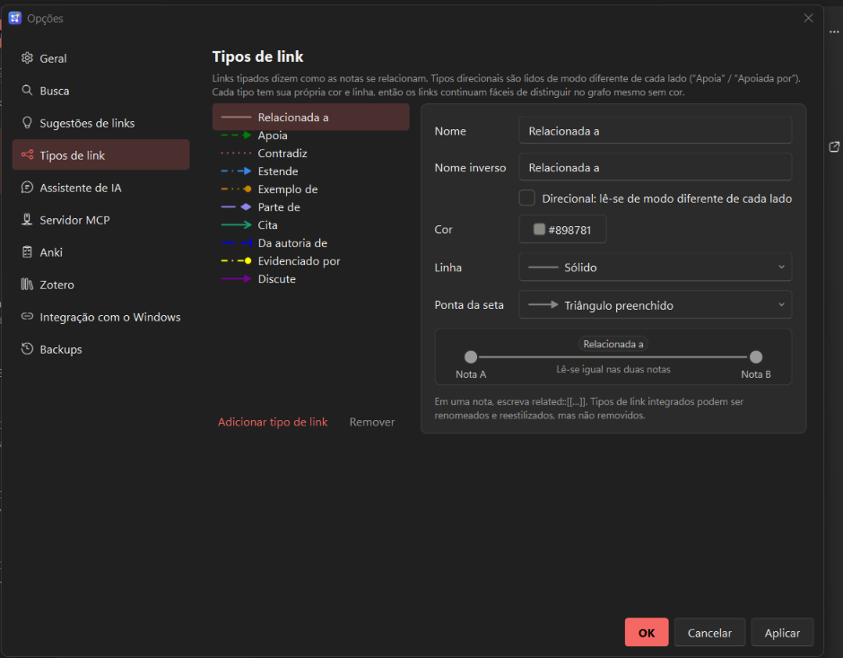
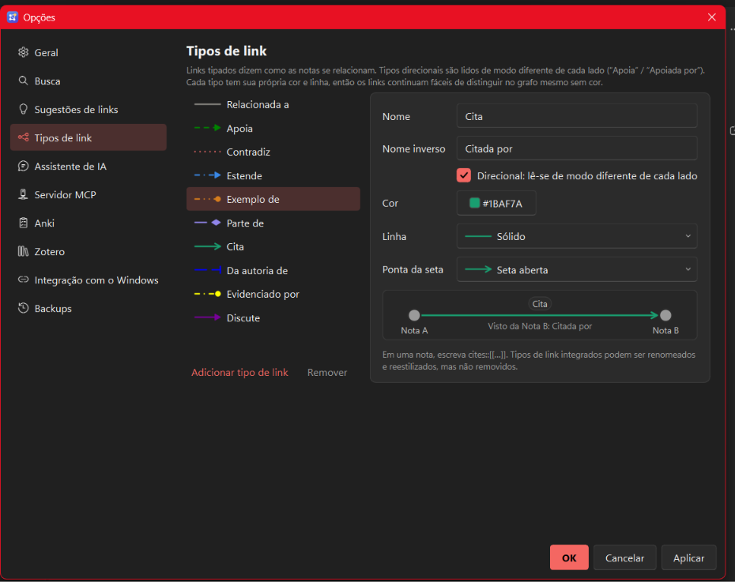
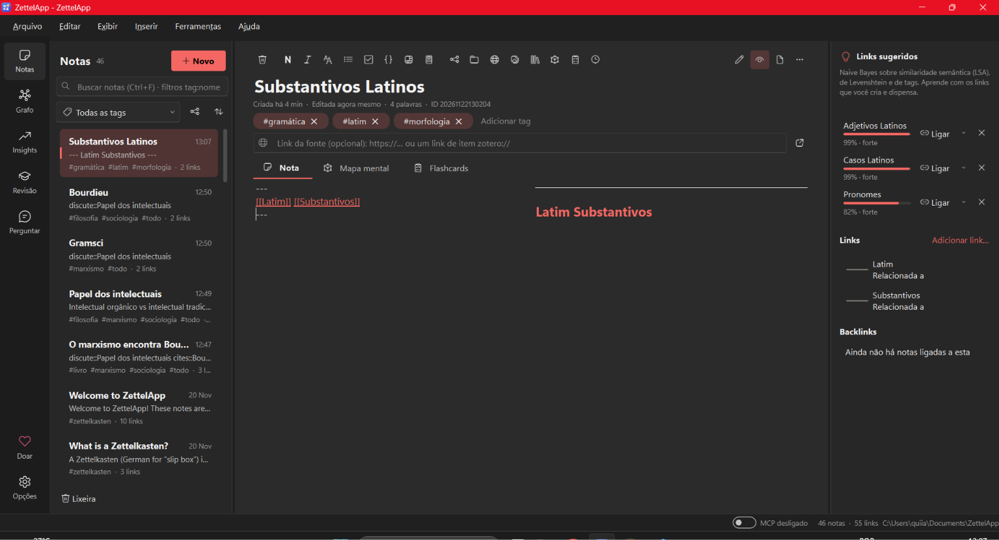
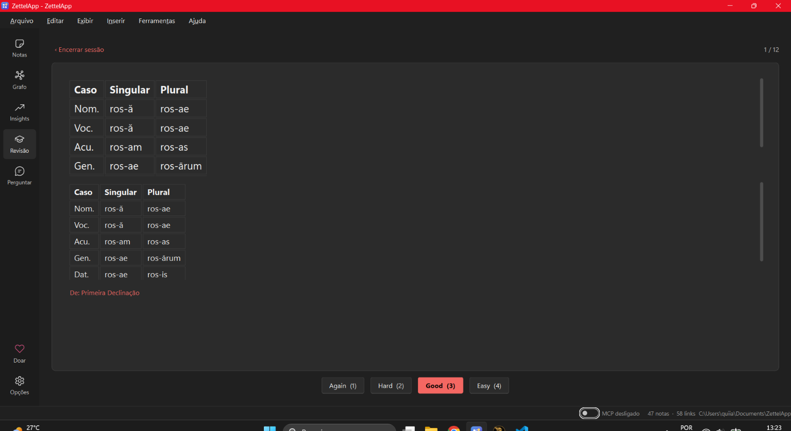
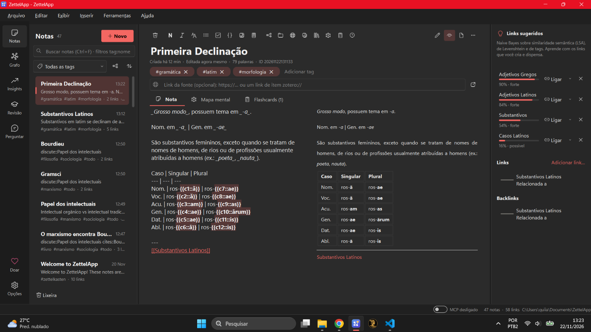
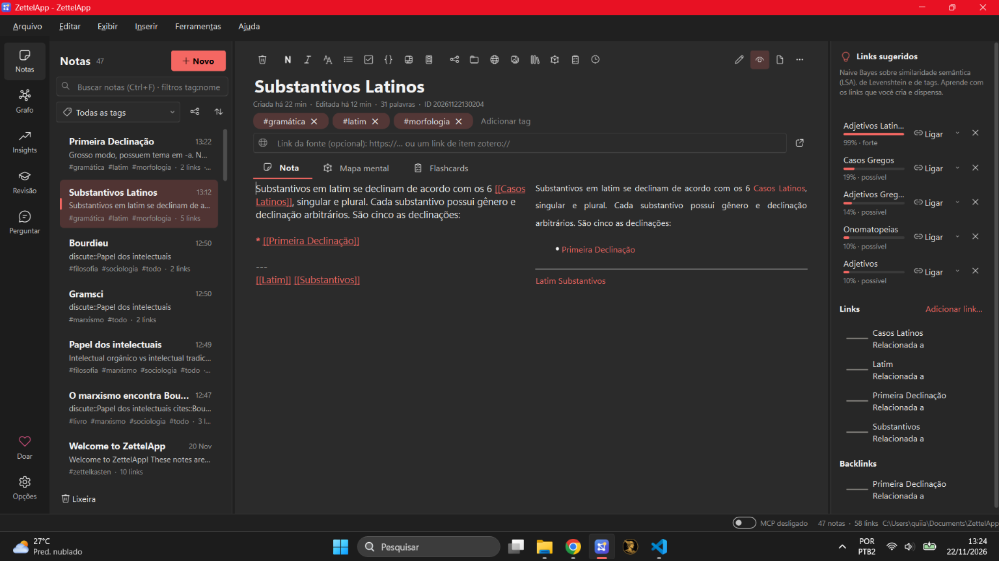
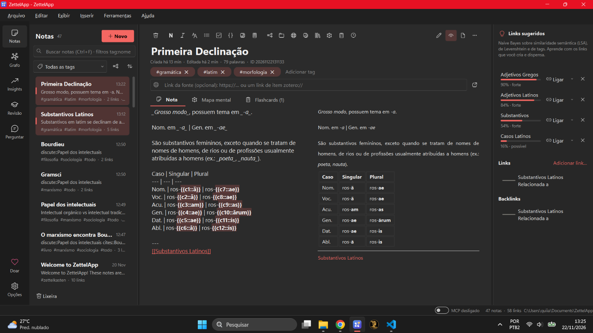
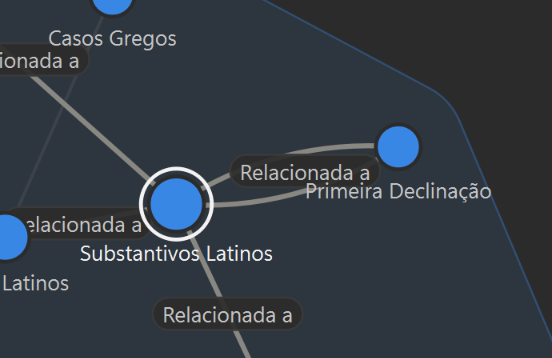
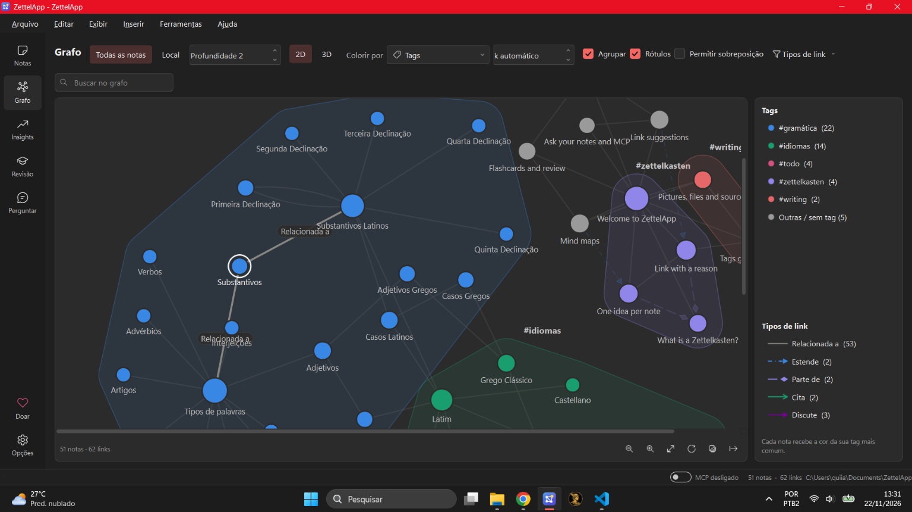

in the graph view, be able to filter link types (one checkbox per link type)
be able to ignore some tags in the clustering (one checkbox per tag)
be able to hide from the graph view some tags (one checkbox per tag)
its not clear how the local graph decides around which note to center

a lista de tipos de links no começo tem bastante overlap, mas após se clicar em um ele expande para o tamanho correto

if i have a directed link type called discusses with the reverse link being discussed_by, i should be able to use discussed_by:[[...]] in a note

currently, if i go to note A and link it to B via the text body, the text body of B is unchanged. option in options to auto add the "link_type::[[A]]" in B's text body when linking from A (default in the bottom of B's text body)

option to auto order the notes list in the left by how close they are to the current active note (updated in real-time as the active note changes, maybe everytime it is saved in case this calculation is expensive), either by link distance or by semantic similarity (default: on and based on semantic similarity)

why does the first --- make a horizontal line and the second one not? search for these inconsistent controls

o que aconteceu aqui com esse cloze?

não há necessidade de duplicar o link quando um link não direcionado aparece reciprocamente em ambas as notas

a simple click on the void should unselect the current note
